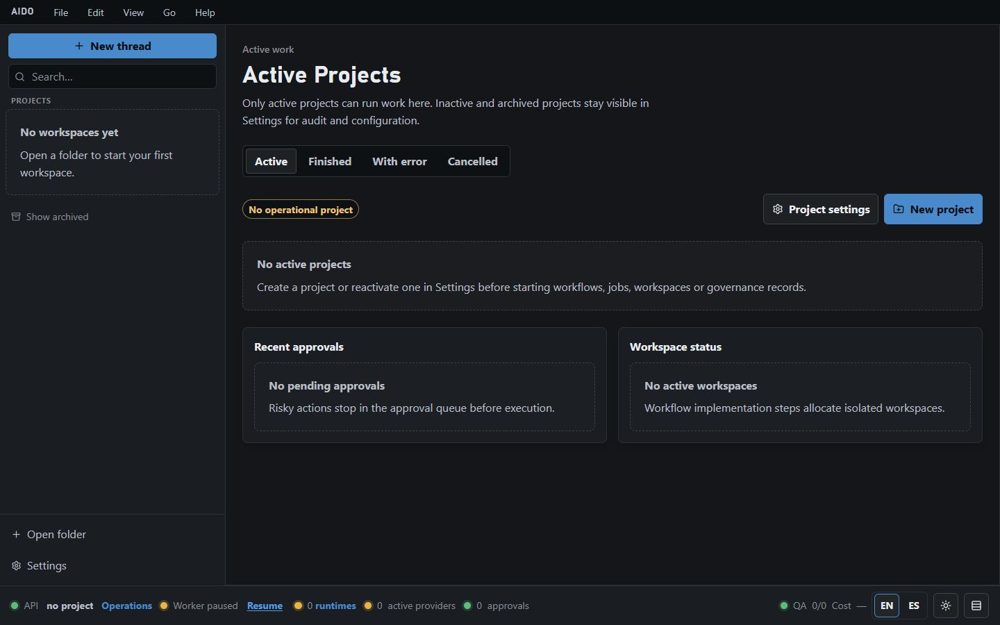

# AIDO Local Control Center

AIDO is an open-source, local-first console for AI-assisted software development. Use it to coordinate coding agents, review changes in isolated Git worktrees, approve actions, and inspect the evidence behind test and QA results.



AIDO is experimental and under active development. See the [Windows validation report](docs/operational-hardening/p0-verification-report.md) for tested scenarios and their scope.

## Quick start

Install Git, [uv](https://docs.astral.sh/uv/), Python from [`.python-version`](.python-version), Node from [`.nvmrc`](.nvmrc), and Corepack. Follow the [installation preflight](docs/operational-hardening/p0-runbook.md#installation-and-preflight) for the SQLite runtime requirements.

Clone the repository and run the installer from the checkout.

```sh
git clone https://github.com/Roddmason/AIDO.git
cd AIDO
```

**Windows (PowerShell)**

```powershell
powershell -NoProfile -ExecutionPolicy Bypass -File scripts/install-local.ps1
```

**Linux or macOS**

```sh
bash scripts/install-local.sh
```

Start the dashboard and worker.

```sh
corepack pnpm@10.24.0 run start
```

Open [http://127.0.0.1:4310](http://127.0.0.1:4310). A fresh database starts with an empty project list. Choose **Open folder** to attach a local repository or **New project** to create one. Set up a runtime in **Settings** before executing agent work. If the worker is paused, choose **Resume** in the status bar.

AIDO keeps projects and their records in the local database. To try AIDO on a machine with an existing installation, you can start it against a fresh database using the launcher’s `--db-path` option.

```sh
uv run python local-control-center/scripts/start_control_center.py --db-path .tmp/aido-preview.sqlite --dashboard-port 4311
```

## What you can do

- **Projects and workspaces** — attach a repository, isolate work in Git worktrees, and track project activity.
- **Workbench and review** — follow agent runs, inspect diffs, and review testing evidence.
- **Runtime and provider settings** — configure supported runtimes and providers. Real provider calls and CLI execution require explicit setup.
- **Approvals and QA** — review permission decisions alongside test results, logs, and artifacts.

See the [workflow guide](docs/workflows.md), [runtime setup](docs/runtime-providers.md), [evidence guide](docs/evidence.md), and [security model](docs/security-policy.md) for details.

## Contributing

Try AIDO on a task in a repository you control. Share what worked, report a reproducible issue, or contribute a fix, test, or documentation improvement.

- [Open an issue](https://github.com/Roddmason/AIDO/issues/new/choose) or read the [contribution guide](CONTRIBUTING.md).
- Keep local databases, worktrees, credential files, and private project outputs out of commits.
- Run the relevant checks and the staged secret scan before pushing.

```sh
git config core.hooksPath .githooks
gitleaks git --staged --config .gitleaks.toml --redact=100 --ignore-gitleaks-allow
```

## License

[MIT](LICENSE). See [NOTICE](NOTICE) and [third-party notices](THIRD_PARTY_NOTICES.md).
